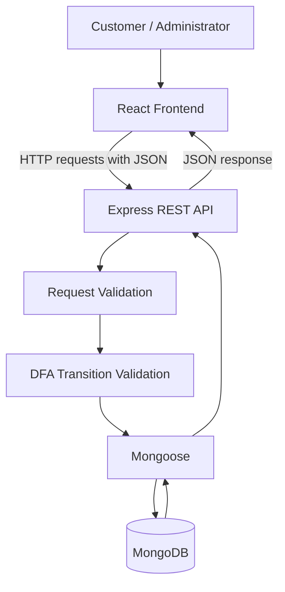
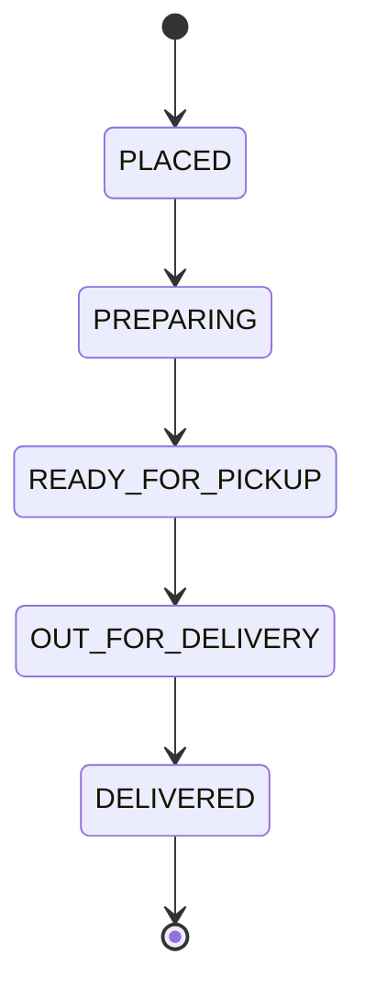

# FoodFlow — Online Food Ordering and Delivery Tracking System Using DFA

## 1. Project Abstract

FoodFlow is a full-stack web application that allows customers to browse a food menu, place orders, and track delivery progress. Administrators can log in and manage order status.

The system uses a Deterministic Finite Automaton (DFA) to validate the order delivery lifecycle. An order moves through predefined states in sequence. Invalid transitions, such as moving from DELIVERED back to PREPARING, are rejected by the backend.

The application uses React for the user interface, Node.js and Express for backend services, and MongoDB for persistent storage.

## 2. Objectives

- Provide an interactive online food ordering interface.
- Validate customer details and order quantities.
- Generate an order tracking identifier.
- Track delivery using a DFA-based state machine.
- Provide authenticated administrator order management.
- Store orders and status history in MongoDB.
- Reject invalid delivery status transitions.
- Demonstrate full-stack development and API-based client-server communication.

## 3. Technologies Used

| Component | Technology |
|---|---|
| Frontend | React, Vite, JavaScript, CSS |
| Icons | Lucide React |
| Backend | Node.js, Express.js |
| Database | MongoDB, Mongoose |
| Configuration | Environment variables using dotenv |
| Communication | HTTP and JSON REST APIs |
| Deployment | Vercel frontend, Render backend |
| Version control | Git and GitHub |
| Automata concept | Deterministic Finite Automaton (DFA) |

## 4. Features

### Customer
- Browse food items, categories, and prices.
- Enter customer and delivery details.
- Select food quantities and place an order.
- Receive an order identifier for tracking.
- View the current delivery status and status history.

### Administrator
- Log in using administrator authentication.
- View stored orders and order statistics.
- Update an order to its next permitted status.
- Receive an error when an invalid transition is attempted.

### Database
- Persist order records in MongoDB.
- Retrieve orders through backend APIs.
- Store delivery status history with timestamps.
- Preserve status history when an invalid transition is rejected.

## 5. System Architecture



The frontend communicates with the backend through HTTP requests. The backend validates incoming requests, checks permitted status transitions, and uses Mongoose to read and write MongoDB records.

## 6. DFA Model

### Definition

The delivery process is modelled as a DFA:

**M = (Q, Σ, δ, q₀, F)**

- **Q — States:** {PLACED, PREPARING, READY_FOR_PICKUP, OUT_FOR_DELIVERY, DELIVERED}
- **Σ — Input alphabet:** The set of delivery status update requests.
- **δ — Transition function:** Accepts only the permitted next status.
- **q₀ — Initial state:** PLACED.
- **F — Accepting states:** {DELIVERED}.

DELIVERED is the final state. No further delivery status transition is permitted after it.

### State Transition Diagram



### Transition Table

| Current State | Input / Next State | Result |
|---|---|---|
| PLACED | PREPARING | Accepted |
| PREPARING | READY_FOR_PICKUP | Accepted |
| READY_FOR_PICKUP | OUT_FOR_DELIVERY | Accepted |
| OUT_FOR_DELIVERY | DELIVERED | Accepted |
| DELIVERED | PREPARING | Rejected |
| DELIVERED | Any further status | Rejected |
| PLACED | DELIVERED | Rejected |
| PREPARING | PLACED | Rejected |

Only the next state in the defined sequence is valid. A rejected transition must not modify the stored status or append an invalid status-history entry.

## 7. Validation Rules

The frontend and backend should enforce compatible validation rules.

| Field | Validation |
|---|---|
| Customer name | 2–100 characters |
| Email | Valid email format |
| Phone | Exactly 10 digits |
| Delivery address | 5–500 characters |
| Quantity | Integer from 1 to 20 |
| Delivery status | Only a permitted DFA transition |
| Administrator operations | Authentication and authorization required |

Invalid input should produce an appropriate error response instead of creating an invalid order or status update.

## 8. REST API Documentation

The deployed backend base URL is:

`https://onlinefooddfa.onrender.com`

| Method | Endpoint | Purpose |
|---|---|---|
| GET | `/` | Backend root response |
| GET | `/api/health` | Health and database connectivity check |
| GET | `/api/foods` | Retrieve the food menu |
| GET | `/api/orders` | Retrieve orders; administrator authentication is required |
| POST | `/api/orders` | Create an order |
| GET | `/api/orders/:id` | Retrieve an order using its supported identifier |
| GET | `/api/orders/:id/history` | Retrieve order history, if exposed by the configured route |
| PATCH | `/api/orders/:id/status` | Request a delivery status update |
| POST | `/api/admin/login` | Administrator login |

For protected administrator endpoints, send the bearer token in the Authorization header.

### Example status update

Request:

```http
PATCH /api/orders/ORDER_ID/status
Content-Type: application/json
Authorization: Bearer YOUR_ADMIN_TOKEN
```

Body:

```json
{
  "status": "PREPARING"
}
```

An invalid backward transition from DELIVERED to PREPARING was tested against the deployed backend and returned HTTP 400. The stored order remained DELIVERED, and no invalid history entry was added.

Note: Replace the example identifier and token with valid test values. Never include real credentials or tokens in screenshots or source control.

## 9. Food Menu

| Food ID | Item | Price |
|---|---|---:|
| F001 | Veg Burger | ₹80 |
| F002 | Margherita Pizza | ₹180 |
| F003 | Veg Fried Rice | ₹120 |
| F004 | Masala Dosa | ₹70 |
| F005 | Paneer Wrap | ₹110 |
| F006 | Chocolate Cake | ₹90 |

Prices and menu records should be confirmed against the current application before submission.

## 10. Testing and Verification

| Test | Expected Result | Recorded Result |
|---|---|---|
| Frontend production build | Build completes without errors | Passed |
| Administrator login API | Successful login returns HTTP 200 | Passed |
| Authenticated order retrieval | Orders are returned | Passed |
| Valid forward DFA transitions | Each permitted next state is accepted | Passed in production testing |
| DELIVERED → PREPARING | HTTP 400; state remains unchanged | Passed in production testing |
| MongoDB order persistence | Stored order remains retrievable | Passed in production testing |
| Responsive menu, tracking, and admin layout | No overlap or clipping | Manual visual verification required |
| All form validation cases | Invalid values are rejected | Verify before final submission |

Testing should include normal inputs, invalid inputs, boundary values, unauthorized requests, valid status transitions, invalid transitions, and database persistence after refreshing or reopening the application.

## 11. Deployment

- **Frontend:** https://foodflow-online.vercel.app/
- **Backend:** https://onlinefooddfa.onrender.com
- **Backend health endpoint:** https://onlinefooddfa.onrender.com/api/health
- **GitHub repository:** https://github.com/Gowthami0812/OnlineFoodDFA

The frontend uses the `VITE_API_URL` environment variable to configure the backend API base URL. For the deployed frontend, configure it as:

`https://onlinefooddfa.onrender.com`

In Vercel, the frontend project uses `client` as its root directory, `npm run build` as the build command, and `dist` as the output directory.

Render's free service may take extra time to respond after inactivity.

## 12. Installation and Local Execution

### Prerequisites

- Node.js and npm
- Git
- MongoDB Atlas account or a local MongoDB instance

### Clone the repository

```bash
git clone https://github.com/Gowthami0812/OnlineFoodDFA.git
cd OnlineFoodDFA
```

### Start the backend

Open a terminal:

```bash
cd server
npm install
```

Create a local `.env` file using the exact environment variable names expected by the backend code. Configure the port, MongoDB connection URI, and any authentication secrets required by the application.

Then run:

```bash
npm start
```

The default local backend URL is `http://localhost:5000`.

### Start the frontend

Open a second terminal:

```bash
cd client
npm install
npm run dev
```

Open the local Vite URL shown in the terminal, normally `http://localhost:5173`.

If necessary, configure `VITE_API_URL` for the local backend. Do not commit `.env` files or expose database credentials, administrator passwords, or JWT secrets.

## 13. Screenshots and Evidence

Store actual screenshots in `docs/screenshots/`.

Recommended evidence:

1. Food menu and category filters.
2. Checkout form and order summary.
3. Successful order confirmation.
4. Delivery tracking timeline and history.
5. Administrator dashboard and order management.
6. Invalid DFA transition response showing HTTP 400.
7. MongoDB order record and status history.

Only add screenshots after capturing them from the real application. Do not use illustrative images as proof of test execution.

## 14. Conclusion

FoodFlow demonstrates a full-stack online food ordering application with persistent data storage and a DFA-controlled delivery lifecycle. The frontend provides ordering and tracking interfaces, while the backend validates requests and restricts delivery updates to permitted state transitions.

The project combines React, Express, MongoDB, REST API communication, authentication, input validation, and formal automata concepts in a practical application.

## 15. References

- React: https://react.dev/
- Vite: https://vite.dev/
- Node.js: https://nodejs.org/
- Express: https://expressjs.com/
- MongoDB: https://www.mongodb.com/docs/
- Mongoose: https://mongoosejs.com/docs/
- Vercel: https://vercel.com/docs
- Render: https://render.com/docs
- Git: https://git-scm.com/doc
